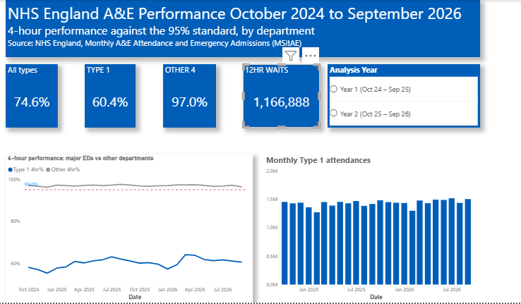

# NHS A&E Performance in England, October 2024 to September 2026

An end-to-end analysis of A&E waiting-time performance in England using NHS England's published monthly statistics. Twenty-four raw monthly files are cleaned and validated in Python, loaded into an Oracle database for analysis in SQL, and presented in a four-page Power BI dashboard.



## Key findings

| Measure | Result |
| --- | --- |
| Patients seen within 4 hours, all A&E types (24 months) | 74.6% (standard: 95%) |
| Major emergency departments (Type 1) | 60.4% |
| Other departments (minor injury units, walk-in centres, UTCs) | 97.0% |
| Type 1 change, Year 1 to Year 2 | 59.7% to 61.0% (+1.3 points) |
| Major departments meeting the 95% standard | 0 of 120 |
| Major departments below 60% | 61 of 120 (51%) |
| Waits of over 12 hours from decision to admit | 1,166,888 (about 121 per 1,000 admissions) |

1. **National performance is about 20 points below the standard, with only modest improvement.** The second winter was milder than the first (December: 71.1% to 73.8%), but Type 1 performance improved by just 1.3 points over the year.
2. **The gap is almost entirely in major emergency departments.** Other departments met 95% every month; Type 1 departments accounted for 96% of all 4-hour breaches.
3. **Winter dips happen without a matching rise in attendances.** Monthly Type 1 attendances stayed at about 1.4 to 1.5 million while performance fell, pointing to pressure after arrival (acuity, bed availability) rather than volume. This is a hypothesis the data cannot confirm.
4. **Performance varies widely between trusts.** Type 1 performance ranged from 43.6% (University Hospitals Plymouth) to 91.7% (Sheffield Children's); the best general acute trust was Homerton at 80.6%.
5. **12-hour waits do not track 4-hour performance.** Trusts with almost identical 4-hour performance had very different 12-hour waits (Hampshire Hospitals 52.9% and 11.5 per 1,000 admissions; Tameside and Glossop 53.5% and 335 per 1,000).

The full interpretation is in the [executive summary](docs/executive_summary.pdf).

## Analytical questions

**Q1. How has A&E 4-hour performance in England changed between October 2024 and September 2026?**
National trend and winter pattern; major (Type 1) versus other departments; distance from the 95% standard; year-on-year change.

**Q2. How does A&E performance vary between NHS trusts?**
Trust rankings; change between years; concentration of 12-hour waits; trusts grouped into pressure bands.

## Data

- **Source:** [NHS England, A&E Attendances and Emergency Admissions](https://www.england.nhs.uk/statistics/statistical-work-areas/ae-waiting-times-and-activity/) (Monthly Situation Report, MSitAE). Accredited official statistics.
- **Coverage:** 24 monthly provider-level CSV files, October 2024 to September 2026; 4,721 rows after cleaning.
- **Grain:** one row per organisation per month.
- **Trust comparisons:** the 120 trusts with a major (Type 1) department and Type 1 activity in all 24 months, identified by organisation code.

The 4-hour standard measures time from arrival to admission, transfer or discharge. The source records patients who waited **over** 4 hours, so performance is calculated as:

```
4-hour performance = (attendances - attendances over 4 hours) / attendances
```

Booked appointments are included in both counts. Percentages are always calculated from summed counts, never by averaging trust percentages, so large and small organisations are weighted correctly.

## Pipeline

```
24 raw CSVs -> Python (clean + validate) -> cleaned CSV -> Oracle SQL (analysis) -> Power BI (dashboard)
```

| Stage | Tool | What it does |
| --- | --- | --- |
| Clean | Python (pandas), VS Code | `clean_ae()` standardises column names, removes the England total row, converts `period` to a date, adds count totals and a Type 1 flag; looped over all 24 files |
| Store and analyse | Oracle Database 26ai, SQL Developer | Table load, then eight analysis queries using aggregation, CTEs, `CASE`, `LAG`, `RANK`, running totals and `KEEP (DENSE_RANK LAST)` |
| Present | Power BI Desktop | Direct Oracle connection, date table, DAX measures, four report pages |

## Dashboard

| Page | Answers | Contents |
| --- | --- | --- |
| National Performance | Q1 | KPI cards; Type 1 vs other departments by month with the 95% line; monthly Type 1 attendances |
| Trust Variation | Q2 | Highest and lowest 10 major departments; Analysis Year slicer |
| Trust Detail | Q2 | All 120 trusts with 4-hour performance, gap to 95% and 12-hour waits; region and year slicers |
| Pressure Bands | Q2 | Trusts grouped by distance from the standard; click a band to filter the trust list |

Key DAX measures: `Type 1 4hr%`, `Other 4hr%`, `Gap to 95%`, `12hr Waits per 1,000` (all built with `DIVIDE` over summed counts), plus calculated columns for each trust's latest name, months reported and pressure band.

## Validation

- **Three tools agree.** October 2024 performance was calculated independently in Python, SQL and DAX: all gave 73.1%, against NHS England's published 73.0%. The 0.1-point difference is attributed to the source file being a later revision.
- **Totals reconcile.** Provider rows sum exactly to the removed England total (2,360,536 attendances; 635,342 breaches for October 2024).
- **Rankings match.** SQL and Power BI return the same 120 trusts, top 10 and bottom 10.

## Data quality

Fourteen issues were found and resolved or documented in the [data quality log](docs/data_quality_log.pdf). The most significant:

- An England **total row** in every file (labelled `TOTAL` or `Total` depending on the month) that would have doubled every national figure.
- Automated column-name cleaning that silently changed meaning (`4-12 hs` became `412_hs`; `12+ hrs` lost its `+`).
- **Eight trusts renamed** during the period. Grouping by code and name split each into two partial records and wrongly dropped them from the rankings; trusts are now identified by code and shown under their latest name.
- A trust whose recorded **admissions halved** from October 2025, inflating its 12-hour wait rate; flagged and kept as reported.

## Repository structure

```
├── data/
│   ├── raw/          # 24 monthly source files (ae_YYYY_MM.csv), unedited
│   └── cleaned/      # ae_clean_2024_10_to_2026_09.csv
├── docs/             # data quality log, executive summary
├── images/           # dashboard screenshots
├── notebooks/
│   └── 01_data_exploration.ipynb   # exploration, cleaning function, validation
├── powerbi/
│   └── nhs_ae_dashboard.pbix
├── sql/
│   ├── 01_create_table.sql
│   ├── 02_q1_national_trend.sql
│   ├── 03_q1_type1_vs_other.sql
│   ├── 04_q1_year_on_year.sql
│   ├── 05_q2_trust_ranking.sql
│   ├── 06_q2_trust_change.sql
│   ├── 07_q2_12hr_waits.sql
│   ├── 08_q2_pressure_bands.sql
│   └── 09_dq_checks.sql
└── README.md
```

## How to run

1. Clone the repository.
2. Install the Python requirements: `pip install pandas numpy`
3. Run `notebooks/01_data_exploration.ipynb` from top to bottom. The cleaned file is written to `data/cleaned/`.
4. In Oracle, run `sql/01_create_table.sql` and import the cleaned CSV into `AE_MONTHLY` (date format `YYYY-MM-DD`).
5. Run the analysis queries in `sql/` in numbered order.
6. Open `powerbi/nhs_ae_dashboard.pbix` and update the Oracle connection (`localhost:1521/FREEPDB1`) to your own database.

## Limitations

- Monthly, trust-level counts only: no patient age, diagnosis, acuity or bed occupancy, so the analysis shows where and when performance falls but not why.
- Trust results use Type 1 performance, which is stricter than NHS England's official all-types trust measure.
- Specialist children's trusts are included in rankings but are not directly comparable with general acute trusts.
- Two years of data show direction of change but cannot separate a lasting trend from year-to-year variation.
- The project table is stored in Oracle's `SYSTEM` schema for simplicity; a dedicated user schema would be used in production.

## Next steps

- Screen all trusts for step changes in recorded admissions (DQ-14).
- Plot 4-hour performance against 12-hour waits for every trust.
- Add bed occupancy data to test the winter capacity hypothesis.
- Automate the pipeline to append new months as NHS England publishes them.

## Author

**Emeka Chukwuma**: pharmacist with over 20 years' experience and MSc Health Informatics student at Swansea University, building a portfolio towards a career in data engineering.

[GitHub](https://github.com/ChukwumaEmeka)
